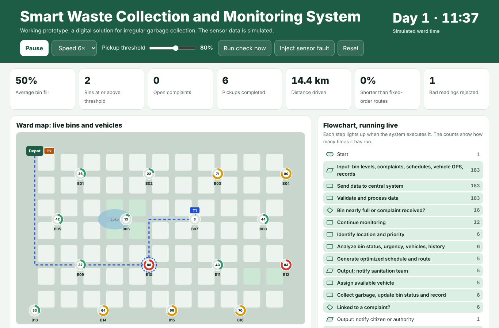

# Smart Waste Collection and Monitoring System

**A digital solution for irregular garbage collection (EVS assignment prototype)**

**🔗 Live demo:** [Live simulation](https://vedanthabbu.github.io/EVS-Project/) · [Guided walkthrough](https://vedanthabbu.github.io/EVS-Project/walkthrough.html)

This is a working web prototype of a smart waste collection system for a city ward. It has two pages, both in dark theme:

- **`index.html`, the live simulation:** everything runs on its own. You can file complaints, inject sensor faults, change the threshold and take trucks out of service.
- **`walkthrough.html`, the guided walkthrough:** one full collection cycle in 6 clickable steps (Next / Back / Play, or the arrow keys), with truck T1 driving its optimised route along the streets. It's the best page for presenting in class.

The simulation It simulates IoT fill-level sensors on 16 public bins, accepts citizen complaints, prioritises bins, plans optimised collection routes for garbage trucks and updates a live dashboard. Every step of the project flowchart runs live on screen.



> The sensor and vehicle data are simulated. This is a proposed prototype concept for an academic assignment and has not been physically deployed.

---

## Features

- **Live ward map**: 16 smart bins, each with a fill-level ring (green, amber, red), plus a depot and garbage trucks that drive their planned routes along the street grid.
- **Flowchart tracker**: each flowchart step lights up when the system executes it, with a running count.
- **Sensor data validation**: impossible readings (outside 0–100%) and sudden drops with no logged collection are rejected. The bin keeps its last valid value.
- **Citizen complaints**: pick a location and an issue to file a complaint. Its status moves from Received to Scheduled to Resolved, and the citizen is notified. A damaged bin also notifies the ward authority. Duplicate complaints are merged.
- **Priority scoring**: each bin gets a priority from its fill level, any open complaint, overflow, site sensitivity (market, hospital, school, transit) and the time since its last pickup.
- **Route optimisation**: Critical bins come first, then nearest-neighbour ordering improved with 2-opt. The page shows the saving against a fixed-order route.
- **Vehicle management**: bins are assigned to available trucks within their 800 kg capacity. Trucks can be sent for maintenance.
- **Dashboard and database**: key figures, an activity and notification feed, and a bin register with fill, status, priority, last collection and pickup count.
- **Controls**: pause or resume, 1×/3×/6× speed, an adjustable pickup threshold, "Run check now", "Inject sensor fault" and reset.

## How the prototype follows the flowchart

| Flowchart step | What the prototype does |
|---|---|
| Start | The system boots with 16 bins online, 2 trucks available and 1 under maintenance |
| Input: bin levels, complaints, schedules, vehicle GPS, records | Each bin reports its fill every 30 simulated minutes; complaints come from the form; truck positions and collection history are tracked |
| Send data to central system | Readings and complaints go to the central controller |
| Validate and process data | Out-of-range readings, unexplained drops and duplicate complaints are rejected or merged |
| Bin nearly full or complaint received? | Is any bin at or above the threshold (default 80%), or does it have an open complaint? |
| Continue monitoring (No) | The monitoring loop keeps running |
| Identify location and priority | A priority score is computed for each pending bin; 110 or more is Critical |
| Analyze bin status, urgency, vehicles, history | Checks fill, urgency, idle trucks, capacity and time since the last pickup |
| Generate optimized schedule and route | Builds a route: Critical bins first, then nearest-neighbour + 2-opt, ending at the depot |
| Output: notify sanitation team | The route, distance and expected return time are posted to the team |
| Assign available vehicle | The driver is dispatched; trucks in maintenance are skipped |
| Collect garbage, update bin status and record | The bin resets and the weight and time are recorded |
| Linked to a complaint? → Notify citizen or authority | The complaint is resolved and the citizen notified; damaged bins are escalated to the ward officer |
| Update database and dashboard | The register, key figures and feed update |
| More pending bins or complaints? | The truck goes to the next stop, re-plans to pick up newly urgent bins, or returns to the depot |
| End collection cycle | The truck unloads at the depot; the system keeps running |

### Priority formula

```
priority = fill %
         + 25  if the bin has an open complaint
         + 15  if the bin is overflowing (≥ 95%)
         + 10  if it is a sensitive site (market, hospital, school, transit hub)
         + 0.5 × hours since last pickup (capped at 24 h)

priority ≥ 110 → Critical,  ≥ 90 → High,  otherwise Medium
```

Trucks are dispatched immediately for complaints, Critical bins, or when three or more bins are pending. A single non-urgent bin waits up to 60 minutes so that nearby bins can be batched into one route.

## How to run

There is nothing to install. It is a single HTML file.

1. Clone or download this repository.
2. Open `index.html` (live simulation) or `walkthrough.html` (guided walkthrough) in any modern browser (Chrome, Edge, Firefox). The two pages link to each other.

### Deploy on GitHub Pages (free)

1. Push this folder to a GitHub repository.
2. Go to **Settings → Pages**.
3. Under **Build and deployment**, choose **Deploy from a branch**, select `main` and `/ (root)`, then click **Save**.
4. After a minute the site is live, e.g. this project at https://vedanthabbu.github.io/EVS-Project/ (walkthrough: https://vedanthabbu.github.io/EVS-Project/walkthrough.html).

## Demo walkthrough

**Quick demo:** open `walkthrough.html` and click **▶ Play**. It runs the whole cycle, from monitoring and detection to route planning, collection, complaint resolution and the end of the cycle.

**Live simulation:**

1. Watch the bins fill up. When one crosses 80%, its ring turns red and the flowchart tracker lights up the decision step.
2. Under **Citizen complaint**, choose a location, for example *B06 · Lake Park*, choose *Bin damaged*, and submit. An orange dot appears on that bin. A truck is dispatched, and the complaint moves to Scheduled and then Resolved. Both a citizen notification and an authority notification appear in the feed.
3. Click **Inject sensor fault**. The feed shows a *Validation* entry rejecting the bad reading.
4. Click **Send to maintenance** on a truck at the depot to see the system plan around fewer vehicles.
5. Lower the **pickup threshold** to 60% to see more bins scheduled and longer optimised routes.

## Tech stack

- HTML, CSS and vanilla JavaScript in one file, with no frameworks or build step
- An SVG map rendered live; the simulation runs in the browser
- Dark theme throughout
- Google Font: Public Sans

## Real-world implementation (proposed)

| Component | Proposed hardware / software |
|---|---|
| Bin fill sensor | HC-SR04 / JSN-SR04T ultrasonic sensor |
| Bin controller | ESP32 microcontroller |
| Connectivity | GSM (SIM800L) or LoRaWAN |
| Vehicle tracking | GPS module (NEO-6M) or the driver's phone |
| Central system | Cloud server with a database (e.g. Firebase / PostgreSQL) |
| Citizen reporting | Mobile app or web form |
| Dashboard | Web dashboard for the municipal sanitation department |

## Project structure

```
EVS-Project/
├── index.html        # live simulation (open in a browser)
├── walkthrough.html  # guided 6-step walkthrough
├── README.md         # this file
└── screenshot.png    # shown at the top of this README
```

## Author

Vedant Habbu, B.E. Computer Science and Engineering, RV Institute of Technology and Management, Bengaluru (VTU)
